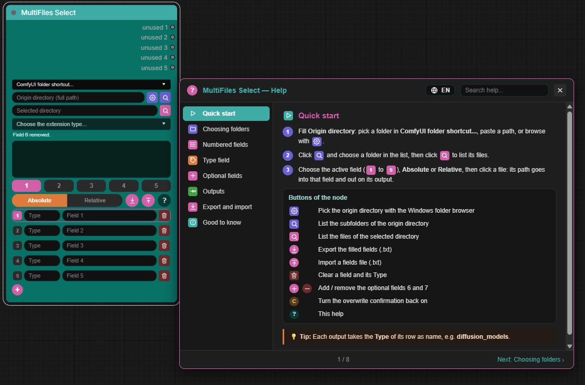

# ComfyUI-MultiFileSelect

[](pyproject.toml)
[](#compatibility)
[](LICENSE)
[](#compatibility)

A ComfyUI custom node that lets you pick up to **5 files** (7 with the two
optional fields) from the same origin directory without typing paths by
hand, and store each one in its own numbered field.

<p align="center">
  
</p>

## Compatibility

Works with the classic node design and with **Modern Node Design (Nodes 2.0)**: in both, output names can be renamed by double-click (or the right-click menu).

Tested on **Windows only**. The **Browse** buttons open the Windows folder
browser; on other systems, type the path instead.

## Installation

1. Clone this repository into your `custom_nodes` folder:

   ```
   cd ComfyUI/custom_nodes
   git clone https://github.com/marche-obscure/MultiFiles-Select.git ComfyUI-MultiFileSelect
   ```

2. Restart ComfyUI.
3. In the node search menu, look for **MultiFiles Select** (category
   `utils/file`).

No extra Python dependency is required.

## Usage

1. **Origin directory**: paste the full path of the starting directory, or
   use the folder icon to pick it with the Windows folder browser (Windows
   only). The **ComfyUI folder shortcut...** drop-down at the top fills this
   field instantly with a standard folder of your installation (root,
   models, output, input, temp, user, custom_nodes), plus
   **Models (Linker)** when an `extra_model_paths.yaml` file exists at the
   ComfyUI root.
2. Click the purple magnifier: the subdirectories that directly contain at
   least one file are listed.
3. Click a folder in the list.
4. Choose the active field with the square buttons **1 2 3 4 5** (plus
   **6** and **7** when the optional fields are added): it will receive
   the next selected file.
5. Click the pink magnifier to list the files of that folder. Filter them
   with the extension menu if needed (it is disabled automatically when
   the folder holds a single extension). `.json`, `.info`, `.md` and
   `.sha*` files are hidden.
6. Choose **Absolute** or **Relative**, then click a file: it is stored in
   the active field in that format. Each field keeps its own format even if
   you switch modes afterwards to fill another one. If the field already
   holds a value, a confirmation is asked before overwriting it (a
   **Don't ask again** box is available; a round **C** icon then appears to
   turn the confirmation back on).

### Type field

Each numbered field is preceded by a small **Type** field, filled
automatically when a file is selected: if the path contains a `models`
folder, it takes the name of the folder right after it (e.g.
`diffusion_models`). It stays empty otherwise and can be edited by hand.
It is informative only and has no output.

### Optional fields 6 and 7

The pink **+** button below the fields adds one extra field at a time:
first field 6 with an **Option 1** output, then field 7 with an
**Option 2** output. The dark red **−** button removes the last added field
with its content and output; if that output is connected, a confirmation
is asked before the link(s) are deleted. The number of added fields is
saved with the workflow.

### Export / import (.json)

- The download icon exports the filled fields to a JSON file named
  `yyyyMMdd-HHmmss_multifileselect_fields.json` (the date keeps a new
  export from overwriting an older one):

  ```json
  {
    "format": "MultiFiles Select",
    "version": 1,
    "fields": [
      { "field": 1, "type": "diffusion_models", "path": "MyFolder\\myfile.safetensors" }
    ]
  }
  ```

- **Save folder**: the gear icon, left of **?**, opens a small window to
  choose the folder where exports are written (path, **Browse**, clear,
  **Cancel** / **OK**; a warning shows if the folder does not exist).
  Without a save folder, the browser downloads the export. The folder is
  saved with the node (in the workflow) and shown when hovering the gear.
- The upload icon next to it reloads a `.json` export (or an older `.txt`
  file, `N - <Type> : <path>` per line) and fills the fields (overwriting
  them without confirmation). A field missing from the file, or an empty
  value, clears the matching field. A filled field 6 or 7 adds the
  matching optional field automatically.

## Outputs

Five outputs named `unused 1` to `unused 5` by default: the path stored in
fields 1 to 5 (the number matches the field), then **model_link**, which
returns the save folder chosen with the gear icon (empty if none), plus
**Option 1** and **Option 2** when the optional fields are added. These are "wildcard" outputs: they can be
connected to any input type, not only STRING. The value passed at run time
is always a string, though, so a connection can still fail at execution if
the downstream node expects a completely different kind of data (an image,
a model, ...).

**Automatic names**: when a file is selected, each output takes the text of
the **Type** field of its row (e.g. `diffusion_models`), and follows it if
you edit that Type by hand. Identical Types are numbered in output order:
`loras (1)`, `loras (2)`. An empty Type gives back the default name.

To rename an output label (e.g. `unused 1` → `Models`), **double-click its
name** on the right side of the node and type the new one (**Enter** or a
click elsewhere to validate, **Esc** to cancel). A name typed by hand is
kept and no longer replaced by the automatic name; clear it to go back to
the automatic name. You can also right-click the node and choose
**Rename output "..."**. This only changes what is shown on the canvas,
not the technical name used at execution; the new label is saved with the
workflow.

## Notes

- The fields remain editable by hand if you prefer typing a path.
- The trash icon to the right of each field clears it (and its Type field)
  immediately, without confirmation.
- The **?** button opens the help: a menu of sections (Quick start first),
  a search field, Previous / Next, and English or French text (globe button).

## License

MIT License — Copyright (c) 2026 marche-obscure. See [LICENSE](LICENSE).

Exception: the images in the `assets` folder (screenshots of the node) are
© 2026 marche-obscure — All rights reserved. They may not be reused,
modified or redistributed separately from MultiFiles Select without prior
written permission.
